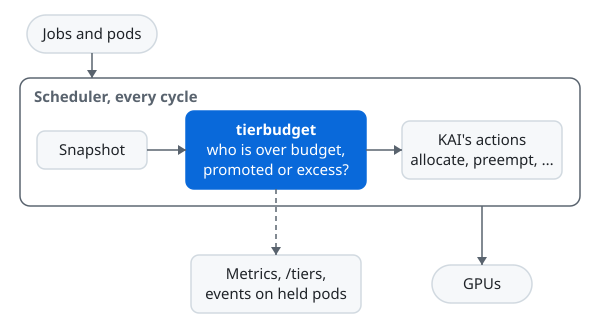

# ukai-scheduler

**Per-user GPU budgets and fair priority tiers for a shared Kubernetes cluster, built on
[KAI Scheduler](https://github.com/kai-scheduler/KAI-Scheduler).**

[](https://github.com/takayuki112/ukai-scheduler/actions/workflows/ci.yaml)
[](LICENSE)

## The problem

Everyone shares one GPU queue, and priority classes decide who goes first. Then everyone
submits everything at high priority, and priority means nothing.

## What this does

Each user gets a **budget** of GPUs at high priority.

- **Above the budget, high-priority jobs wait**, even if GPUs are free, and say why.
- **Unused budget is not wasted.** A user's running medium-priority jobs are *promoted*
  into it, and are then as safe from eviction as high-priority jobs.
- **Nobody hogs the middle either.** Beyond an *allowance*, medium-priority jobs become
  *excess*: they still run on idle GPUs, but give way first.
- **Promotion lends, it does not give.** When the user submits a high-priority job, their
  own promoted jobs make room.

<picture>
  <source media="(prefers-color-scheme: dark)" srcset="docs/images/story-dark.svg">
  
</picture>

*8 GPUs, a budget of 4 and an allowance of 2 per user. A
[test](pkg/tierbudget/story_test.go) runs these steps through the scheduler.*

<details>
<summary>The same in words</summary>

| | What happens | Running | Waiting |
|---|---|---|---|
| 1 | Alice starts a P2, `train`, on 4 GPUs. Alice's budget is unused, so it is promoted to P1 priority. | train (promoted) | |
| 2 | Bob starts a P1, `eval`, on 4 GPUs. It fits Bob's budget. | train (promoted), eval | |
| 3 | Bob submits another P1, `eval2`, on 2 GPUs. Bob's budget is used up, so it is held, and evicts nobody. | train (promoted), eval | eval2 (held) |
| 4 | Alice submits a P1, `debug`, on 4 GPUs. It takes Alice's budget back: train is demoted, as excess because it is larger than the allowance, and makes room. | debug, eval | eval2 (held), train (excess) |
| 5 | eval ends. eval2 fits Bob's budget, and starts. The 2 free GPUs are too few for train. | debug, eval2 | train (excess) |
| 6 | eval2 ends. Idle GPUs go to anyone, so train runs again. | debug, train (excess) | |

</details>

P1, P2 and P3 stand for your high, medium and low priority classes. See
[concepts](docs/concepts.md) for the exact rules.

## How it works

It is **not a fork**. It is KAI v0.18.9 with one added plugin and one added action, and
replaces only the scheduler's image. Tiers are worked out afresh every cycle from what is
running, and change only KAI's in-memory copy of a job's priority: nothing is stored, your
objects are not modified, and a change of tier restarts nothing by itself.

<picture>
  <source media="(prefers-color-scheme: dark)" srcset="docs/images/overview-dark.svg">
  
</picture>

If the configuration is wrong or the plugin fails, the scheduler behaves as stock KAI.

## Try it

| You want to | Cost | How |
|---|---|---|
| See what it would do to **your** cluster | Nothing is installed | [Replay a snapshot](docs/install.md#1-replay-a-snapshot) |
| Watch its decisions live | Audit mode: it only logs | [Audit](docs/install.md#3-audit) |
| Play with it on a laptop | kind, with fake GPUs | [Testing](docs/testing.md) |

Replay prints what would change, next to stock KAI:

```
JOB            USER   CLASS  UNITS  STATE    TIER      PRIORITY     STOCK   WITH PLUGIN  REASON
team/pg-eval2  bob    high   2      pending  held      75           placed  -            needs 2 units, using 4 of 4
team/pg-train  alice  mid    4      running  promoted  75 (was 50)  -       -
```

## Documentation

| For | Page |
|---|---|
| Everyone | [Concepts](docs/concepts.md): the rules, with examples |
| Users, who submit jobs | [User guide](docs/user-guide.md): why is my job waiting? |
| | [Dashboard](docs/dashboard.md): your budget and jobs, live in a terminal |
| Cluster admins | [Install](docs/install.md): replay, audit, enforce, roll back |
| | [Configuration](docs/configuration.md): every setting |
| | [Security](docs/security.md): keep users from evading the rules |
| | [Observability](docs/observability.md): metrics and the status endpoint |
| | [Troubleshooting](docs/troubleshooting.md) |
| Developers | [Architecture](docs/architecture.md), [Testing](docs/testing.md) |
| | [Future work](docs/future.md): what is planned |
| | [Ladder](docs/ladder.md): an experimental alternative to the budget, compared with it |

## Status

**Not yet used in production.** Tested with KAI v0.18.9 on kind with fake GPUs, on arm64 and
amd64, with Kubernetes 1.32 to 1.37. Not tested with real GPUs or other KAI versions. See [what is tested](docs/testing.md).

## License

[Apache-2.0](LICENSE). An independent project, not affiliated with KAI Scheduler or NVIDIA.
KAI Scheduler is also licensed under Apache-2.0; images include its LICENSE and NOTICE.
