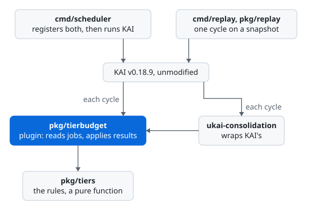
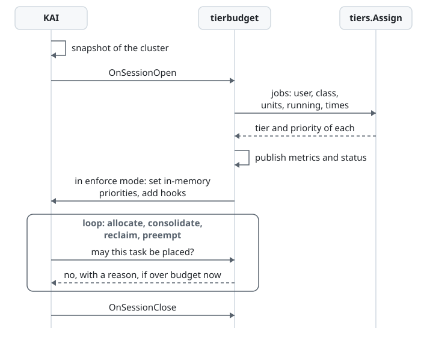

# Architecture

<picture>
  <source media="(prefers-color-scheme: dark)" srcset="images/components-dark.svg">
  
</picture>

## One cycle

<picture>
  <source media="(prefers-color-scheme: dark)" srcset="images/cycle-dark.svg">
  
</picture>

## Decisions

**Priorities are changed only in memory.** KAI rebuilds its copy each cycle, so a crash, a
restart or an uninstall leaves nothing behind. Whether a job is preemptible is decided before,
from its original class.

**The budget is checked again at each placement**, from live pod statuses, which KAI also
updates for simulated placements and restores when it rolls them back. So several jobs placed in
one cycle cannot exceed it together.

**Held jobs also leave the search for victims early.** Otherwise KAI would look for jobs to evict
on their behalf, and conclude that similar jobs of other users cannot be placed either.

**Users are independent.** No decision about one depends on another's jobs, except through GPUs.

**Failures leave stock KAI.** Nothing is applied until all is computed, and panics are caught.

**The status endpoint is registered once.** KAI's server reads its handlers without a lock, so
adding one while serving could crash the process.

**Pods without a PodGroup still count.** Deleting a Job deletes its PodGroup at once. The plugin
finds such pods on their nodes, and remembers the user, or after a restart reads the pod's label.

## Cost

About 10 ms per cycle, of a cycle of 1.5 to 2.5 s: measured with 200 simulated nodes, some 2,900
pending pods, and KAI's default limit of 0.7 CPU, see [testing](testing.md). Stock KAI's cycles were as long, but
runs vary too much to compare them closely.

## Limits

- Same budget for everyone.
- One KAI version at a time: it compiles against KAI's internals.
- A stream of small budgeted jobs can delay a large one of the same user.
- A gang can be left waiting if one of its pods finishes and another is evicted, as in stock KAI,
  see [future work](future.md#gangs-that-lose-a-pod-after-another-has-finished).
- `go install` by version does not work, because KAI needs `replace` directives.
