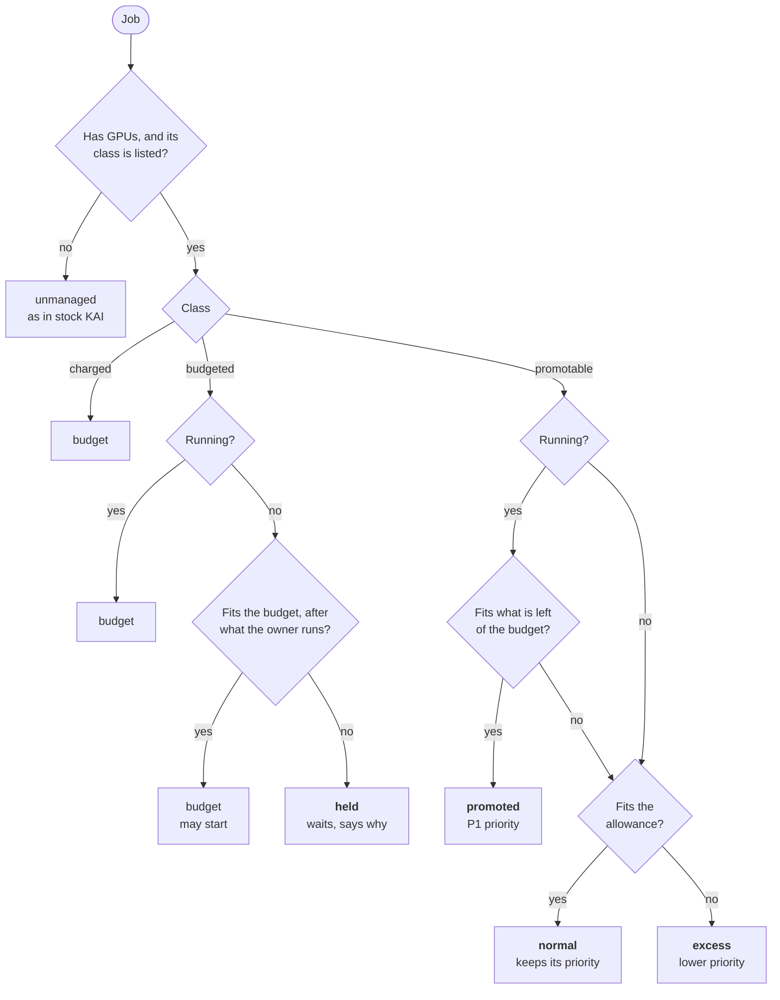

# Concepts

## Words

| Word | Meaning |
|---|---|
| **Job** | Whatever KAI schedules as one: a PodGroup, usually one Kubernetes Job |
| **Owner** | The value of a label on the job, normally a person |
| **Unit** | One GPU, times a weight that you may set by GPU type |
| **Budget** | Units that each owner may run at high priority |
| **Allowance** | Units of medium-priority work that keep their priority |
| **Tier** | What the scheduler makes of a job in this cycle |

The documentation calls four priority classes P0 to P3. Names and values are yours, and you
need not have all of them.

| Example class | Value | Treated as | Behaviour |
|---|---|---|---|
| P0 | 90 | *not listed* | Untouched: no budget, may evict all below |
| P1 | 75 | **budgeted** | Runs up to the budget, then waits |
| a workspace | 75 | **charged** | Uses the budget, but never waits for it |
| P2 | 50 | **promotable** | May be promoted to 75, or drop to 45 as excess |
| P3 | 25 | *not listed* | Untouched |

## Tiers

## The rules

**Budget.** A P1 starts if it fits next to the P1 and charged jobs that its owner is
*running*. One that does not fit does not block smaller ones behind it. The budget holds even
when GPUs are idle, so that people use P2 for the rest. An owner already above the budget,
for example on the day you switch it on, keeps running jobs and just cannot start more.

**Promotion.** What P1 leaves of the budget goes to the owner's running P2, *longest running
first*. A waiting P1 that fits the budget takes it back. One that does not fit, for example
because it is larger than the budget, leaves promotions alone. Pending jobs are never promoted.

**Allowance.** Of the remaining P2, *earliest submitted first*, the first units up to the
allowance stay normal and the rest are excess. Running jobs come before pending ones.

**Excess still runs.** It uses idle GPUs and can evict lower classes, but any P2 within its
owner's allowance may evict it.

**All of a job or nothing.** A job is charged in full from when it starts, until its last pod
is gone. Deleting a job does not free budget while its pods still terminate.

## Examples

Budget 4, allowance 4.

### Alice runs only P2

| Started | Job | GPUs | Tier | Priority |
|---|---|---|---|---|
| 09:00 | A | 2 | promoted | 75 |
| 09:30 | B | 2 | promoted | 75 |
| 10:00 | C | 2 | normal | 50 |
| 10:30 | D | 2 | normal | 50 |
| 11:00 | E | 2 | excess | 45 |

### Then a P1 of 2 GPUs

The P1 reserves 2 units, so only A stays promoted. B, C and D, E compete for the allowance:

| Job | GPUs | Tier | Priority |
|---|---|---|---|
| *P1* | 2 | budget | 75 |
| A | 2 | promoted | 75 |
| B | 2 | normal | 50 |
| C | 2 | normal | 50 |
| D | 2 | excess | 45 |
| E | 2 | excess | 45 |

Nothing has restarted. If GPUs are free, the P1 starts on them. If not, it may evict a job of
lower priority, lowest first.

### A P1 that is too large

With 2 of 4 units in use, a P1 of 4 is held: `owner budget: needs 4 units, using 2 of 4`.
Promotions stay, and a P1 of 2 behind it starts.

### Who can evict whom?

Usually a job evicts only jobs of lower priority, in the same queue:

| | P0 (90) | P1, promoted (75) | P2 (50) | excess (45) | P3 (25) |
|---|---|---|---|---|---|
| **P0** evicts | | ✓ | ✓ | ✓ | ✓ |
| **P1** evicts | | | ✓ | ✓ | ✓ |
| **P2** evicts | | | | ✓ | ✓ |
| **excess** evicts | | | | | ✓ |

A promoted job evicts nobody as such: it is already running. Between queues, KAI's own fair
share applies as before.

## Questions

**Why longest running first for promotion, but earliest submitted for the allowance?** A job
that has just started must not displace one that is promoted. For the allowance, start order
would let a job evict another, drop to excess, and be evicted in turn, endlessly.

**Does a promoted job stay promoted?** Until its owner uses the budget for P1. Then as few are
demoted as needed.

**Is an unused budget kept free?** No. Idle GPUs are for anyone.

**Can one person block others with many P1?** Only up to the budget at a time.
