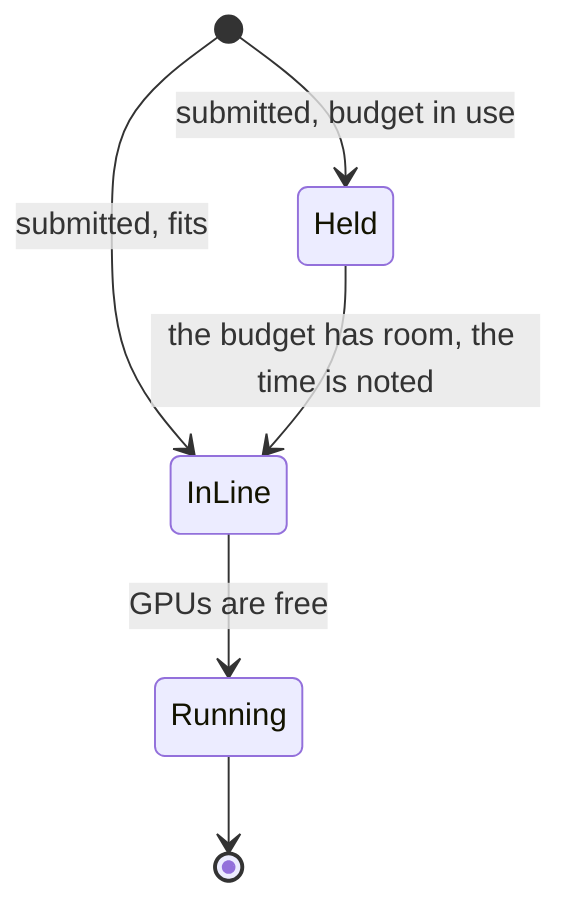

# Future work

Nothing here is implemented, and the settings do not exist yet. Each idea says what it is for,
how it could work, and what is still to be decided.

## Queue order when GPUs are full

**Today.** If all users' P1 together need more GPUs than there are, P1 wait in the order of
submission, see [concepts](concepts.md#when-p1-alone-fills-the-cluster). A held job keeps its
place. A user who submits many jobs early is therefore ahead of those who come later, each time
the user's budget frees up:

| 4 GPUs, a budget of 4 | Order of starts |
|---|---|
| Alice submits `a1`, `a2`, `a3`, then Bob `b1`, each of 4 GPUs | |
| By submission (today) | a1, a2, a3, **b1** |
| By eligibility (planned) | a1, **b1**, a2, a3 |

**The plan.** A setting, proposed as `queueOrder`:

| Value | A P1's place in the queue is from |
|---|---|
| `submission` (default) | its creation, as today |
| `eligible` | when it first fitted its user's budget |

A user's waiting P1 are taken oldest first. Each that fits next to what the user runs, and next
to those already in line, joins the line. The rest are held and have no place in it. So a user
has at most one budget of work in line, however many jobs they submit.

**How it could work**

- Admission is what `pkg/tiers` already computes to decide whether waiting P1 leave budget for
  promotion. It would also return which jobs are in line.
- The plugin would add a job order function, which KAI asks after priority and elasticity. Every
  job needs one consistent time, or the order is not an order: the noted time for P1 in line, and
  the creation time for all others. Ties go by creation, then UID.
- KAI also uses the job order, reversed, to choose victims. For running jobs the creation time
  would be kept, so that who is evicted does not change.
- The time must survive restarts and failover. Options: in memory only, so that a restart falls
  back to submission order; or an annotation on the PodGroup, as KAI does for its own start time.
  An annotation costs a write for each job, needs the right to patch PodGroups, and must be as
  safe from users as the PodGroup itself, see [security](security.md).
- In `audit`, the order would be reported and not applied.

**To be decided**

- Where the time is kept. Suggested: the annotation, as users would notice a lost place.
- Whether a job that no longer fits, because the user started charged jobs, loses its place.
  Suggested: yes; it joins again at the end.
- Whether a P1 that was evicted goes back to its old place. Suggested: yes.
- What happens to a user's small P1 while a large one of theirs is in line but does not fit the free
  GPUs. Today the small one starts. If it may not, at most one budget of work is in line, but GPUs
  can stay idle. Suggested: it may start, but only after all that are in line.

**Tests.** `TestContention` states today's order, and would run with both settings. Further: a
restart in the middle, at most one budget of work in line for random jobs, no change in who is
evicted, and that the default leaves the order as it is.

## Other ideas

- **Reserve GPUs for a large job.** Smaller P1 that fit may overtake a large one without end, as
  in stock KAI. A reservation after some waiting time would stop that, but leaves GPUs idle, and
  needs to know where the job will fit.
- **Least use first.** Among waiting P1, the user who runs the least goes first. Needs no memory,
  but is no longer first come, first served.
