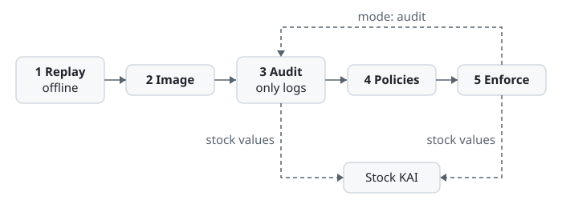

# Install

For admins of a cluster that runs **KAI v0.18.9**. Each step is safe to stop at.

<picture>
  <source media="(prefers-color-scheme: dark)" srcset="images/install-dark.svg">
  
</picture>

## Before you start

| Check | Why |
|---|---|
| KAI is v0.18.9 | It replaces that version's scheduler |
| Jobs have a label that names their user, on the Job **and** its pods | Budgets are by user |
| Priority classes, and which are budgeted and promotable | |
| Nobody but KAI can write PodGroups | The user and class are read there, see [security](security.md) |
| You can edit KAI's Helm values, and restart the scheduler | |

### Memory limits

In a test with 200 nodes and 3,000 jobs, with the default limits, KAI's binder (200 MiB) and
pod-grouper (512 MiB) were killed for lack of memory, and the scheduler (512 MiB) came within
20 MiB of its limit. Stock KAI was the same. Compare your cluster's use with the limits before
you start, and raise them if they are close.

### Evictions and retries

By default, each eviction counts against a Job's `backoffLimit`, in stock KAI too. To avoid that, set
`scheduler.args.update-pod-eviction-condition: "true"` in KAI's values, and have Jobs ignore it:

```yaml
podFailurePolicy:          # in the Job's spec; the pods need restartPolicy: Never
  rules:
    - action: Ignore
      onPodConditions: [{type: DisruptionTarget, status: "True"}]
```

## 1. Replay a snapshot

Runs one scheduling cycle offline, as stock KAI and with the plugin, and lists what differs.
KAI's `snapshot` plugin, on by default, provides the snapshot. **It has full pod specs and
ConfigMaps, which may contain secrets: treat it so.**

    kubectl -n kai-scheduler port-forward deployment/kai-scheduler-default 8081
    curl localhost:8081/get-snapshot -o snapshot.zip
    go run ./cmd/replay -snapshot snapshot.zip -arguments arguments.yaml

`arguments.yaml` is a map of the [arguments](configuration.md), for example:

```yaml
ownerLabel: example.com/owner
budgetedClasses: high
promotableClasses: mid
budget: "4"
allowance: "4"
promotedPriority: "75"
excessPriority: "45"
```

Look for jobs that are unexpectedly held, jobs whose `USER` is `-` (no label for the user), and evictions. `-all`
lists every managed job. It does not show preemption that takes several cycles.

## 2. Build the image

    CGO_ENABLED=0 GOOS=linux GOARCH=amd64 go build -trimpath -o image/scheduler ./cmd/scheduler
    kai=$(go list -m -f '{{.Dir}}' github.com/kai-scheduler/KAI-scheduler)
    install -m 644 "$kai/LICENSE" "$kai/NOTICE" image/
    docker build -t <registry>/ukai-scheduler:<tag> -f Dockerfile image

KAI's chart has one registry for all its images. Either mirror KAI's images next to this one,
or set the scheduler's image in the KAI `Config` resource.

## 3. Audit

Install with `mode: audit`, see [configuration](configuration.md), keeping your other values.
Then restart the scheduler, as it reads its configuration at the start:

    kubectl -n kai-scheduler rollout restart deployment/kai-scheduler-default
    kubectl -n kai-scheduler logs deployment/kai-scheduler-default | grep tierbudget

Expect `Plugin tierbudget loaded` and one line for each job that changes tier. Scheduling is as
before, and running jobs are not touched.

Leave it for a week or two, and compare with what users expect. Watch the
[metrics](observability.md): `ukai_active` is 1, `ukai_panics_total` is 0, and
`ukai_tier_changes_total` grows only as jobs come and go.

## 4. Policies

Apply those in [security](security.md) before enforcing, in audit mode first. Otherwise the
rules hold only for those who keep to them. Tell users about the [user guide](user-guide.md).

## 5. Enforce

Set `mode: enforce` and restart the scheduler. To go step by step, first apply
only budgets: leave out `promotableClasses`, and set `protectedPriority`, which is then required.

Jobs above a budget keep running; their users just cannot start more.

## Rolling back

| To | Do | Effect |
|---|---|---|
| Stop enforcing | `mode: audit`, restart | Held jobs start; running ones are not touched |
| Return to stock KAI | `helm upgrade` with the stock values: no plugin, no `ukai-consolidation`, stock image | The same |

> **Remove the configuration together with the image.** The stock image does not start while its
> configuration names `ukai-consolidation`: the scheduler crash-loops. Running jobs are not
> affected, and it recovers once the configuration is corrected.

All of these, and the mistake, are [tested](testing.md) with jobs running.
