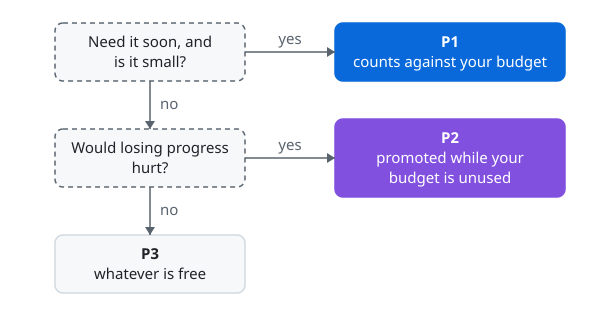

# User guide

For users: those who submit jobs. Your cluster's class names and numbers may differ: ask your admins.

## Which class?

<picture>
  <source media="(prefers-color-scheme: dark)" srcset="images/which-dark.svg">
  
</picture>

Do not use P1 for everything: beyond the budget it waits even when GPUs are idle, where a P2
would run.

## Why is my job waiting?

    kubectl describe pod <pod>

| Message | Meaning | What to do |
|---|---|---|
| `user budget: needs 2 units, using 4 of 4` | Your budget is in use | Wait, stop a P1, or resubmit as P2 |
| `user budget: needs 8 units, budget is 4` | It can never fit | Resubmit as P2, or smaller |
| `user budget: no user: label ... is not set` | The label that says whose job it is, is missing | Set it, or ask your admins |
| anything else | KAI's own reason, such as no free GPUs | |

The [dashboard](dashboard.md) shows this live, with your budget and the queue.

## Your job was evicted

Evicted pods get SIGTERM, then a grace period (30 seconds unless the job sets another), then
SIGKILL. So:

1. **Save a checkpoint on SIGTERM**, and at intervals.
2. **Resume from the last checkpoint** on start.
3. **Exit with an error on SIGTERM, not with 0.** A Job whose program exits 0 counts as
   complete, and does not run again.

```python
import signal, sys

stop = False

def on_term(signum, frame):
    global stop
    stop = True

signal.signal(signal.SIGTERM, on_term)

start = load_checkpoint_if_any()
for step in range(start, total):
    train_step(step)
    if stop:
        save_checkpoint(step + 1)
        sys.exit(143)  # not 0: there is more to do
```

Set `terminationGracePeriodSeconds` to what a checkpoint takes, within your cluster's limit,
and allow retries in the Job's `backoffLimit`. Kubernetes waits before it replaces a Job's evicted
pod, longer each time, up to 10 minutes. Until then there is no pod to see.

## Example

```yaml
apiVersion: batch/v1
kind: Job
metadata:
  name: train
  labels:
    kai.scheduler/queue: team
    example.com/user: alice        # may be set for you
spec:
  backoffLimit: 20
  template:
    metadata:
      labels:
        kai.scheduler/queue: team
        example.com/user: alice    # also here
    spec:
      schedulerName: kai-scheduler
      priorityClassName: mid        # your P2
      restartPolicy: Never
      terminationGracePeriodSeconds: 120
      containers:
        - name: main
          image: my/image
          resources:
            limits: {nvidia.com/gpu: 4}
```

## My job says P2. Is it promoted?

The class shown never changes, as promotion is only in the scheduler. Your admins may offer a
dashboard from the [metrics](observability.md).
